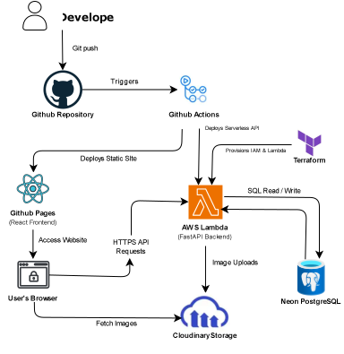

# 🍕 Sip & Slice: Serverless E-Commerce Platform


**Live Application:** https://neil-023.github.io/sip-and-slice-aws

Sip & Slice is a modern, full-stack food e-commerce platform built on a scalable serverless architecture. Powered by a responsive React frontend and a high-performance FastAPI backend running on AWS Lambda, the application uses Neon PostgreSQL for managed relational data and Cloudinary for optimized media delivery to ensure fast load times, automated CI/CD deployments, and seamless order management.

## 🏗️ Cloud Architecture

The application relies on decoupled services communicating via RESTful APIs, with deployment pipelines fully automated through GitHub Actions.

<div align="center">
  
</div>

<details>
<summary><b>View Text-Based Data Flow</b></summary>

```text
 [ Developer ]
       |
       | Git push
       v
[ Github Repository ] ---- Triggers ----> [ Github Actions ]
                                                |
          +-------------------------------------+
          | Deploys Static Site                 | Deploys Serverless API
          v                                     v
  [ Github Pages ]                        [ AWS Lambda ] <----(SQL Read / Write)----> [ Neon PostgreSQL ]
  (React Frontend)                       (FastAPI Backend)
          |                                     |
          | Access Website                      | Image Uploads
          v                                     v
  [ User's Browser ] ---------------> [ Cloudinary Storage ]
          |           Fetch Images 
          |
          +--------(HTTPS API Requests)-------> [ AWS Lambda ]
```
</details>

🛠️ Infrastructure Stack
Compute (Backend): AWS Lambda (Python/FastAPI adapted with Mangum for serverless execution).

Hosting (Frontend): GitHub Pages serving a compiled React/Vite SPA.

Database: Neon PostgreSQL (Cloud-native, serverless SQL).

Media Storage: Cloudinary (Handling dynamic image uploads and delivery).

CI/CD: GitHub Actions (Independent frontend and backend deployment workflows).

⚙️ CI/CD Pipelines
The repository utilizes two independent GitHub Actions workflows to ensure zero-downtime deployments:

Frontend Pipeline (deploy-frontend.yml): Triggers on pushes to the /frontend directory. Builds the Vite React app and publishes the static assets to the gh-pages branch.

Backend Pipeline (deploy-backend.yml): Triggers on pushes to the /backend directory. Packages the FastAPI application and its dependencies, authenticates with AWS via IAM roles/secrets, and updates the AWS Lambda function code.

💻 Local Development Setup
To run this project locally for development or testing:

1. Clone the repository


```bash
git clone https://github.com/yourusername/sip-and-slice.git
cd sip-and-slice
```
2. Backend Setup (FastAPI)

```bash
cd backend
python -m venv venv
source venv/bin/activate  # On Windows: venv\Scripts\activate
pip install -r requirements.txt
```
Create a .env file in the /backend directory and add your Neon DATABASE_URL and Cloudinary API keys.

```bash
fastapi dev main.py
```
3. Frontend Setup (React/Vite)
```bash
cd frontend
npm install
npm run dev
```